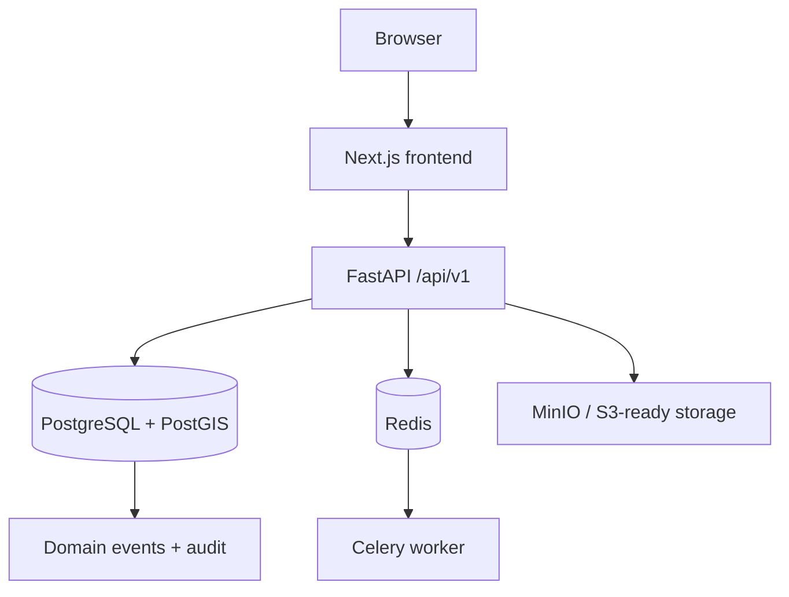

# Architecture



## Domain boundaries

- authentication and users
- departments
- assets
- incidents
- inspections
- maintenance/work orders
- provenance
- analytics
- public reporting
- audit/events

## Source of truth

PostgreSQL/PostGIS remains the operational source of truth.

Redis is for transient/cache/job-broker concerns.

Object storage is for evidence and large objects; metadata belongs in PostgreSQL.

Part 2 can consume stable APIs and events without embedding ML logic in CRUD handlers.

## Completion rule

A production feature should cross:

```text
database → validation → service/workflow → API
→ authorization → UI → errors → logging → tests → documentation
```
